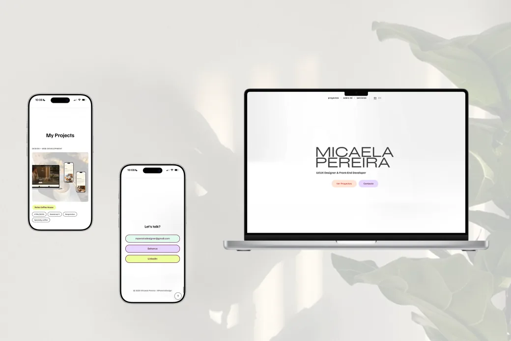

# MPereiraDesign

Portfolio de **Micaela Pereira**, UI/UX Designer & Front-End Developer. Un sitio de una sola página con mis proyectos, quién soy, qué ofrezco y cómo contactarme.



## Qué tiene

- **Bilingüe:** español por defecto e inglés en [`/en/`](en/), con el mismo diseño.
- **Responsive:** desde celulares de 320px hasta pantallas grandes, con composiciones pensadas para cada tamaño.
- **Accesible:**
  - contraste WCAG AA en todos los textos de botones;
  - navegación completa con teclado y foco siempre visible;
  - textos alternativos en todas las imágenes;
  - las animaciones se apagan si el usuario eligió "reducir movimiento".
- **Liviano:** imágenes en WebP, con versiones más chicas para celular, y CSS comprimido.

Resultados de Lighthouse en celular:

| Rendimiento | Accesibilidad | Buenas prácticas | SEO |
|:---:|:---:|:---:|:---:|
| 91 | 100 | 100 | 100 |

## Proyectos

- **Delos Coffee House:** sitio web de una cafetería de especialidad en Tigre. [Ver sitio](https://proyecto-final-delos-coffee.vercel.app/) · [Ver código](https://github.com/micaelapereira/proyecto-final-delos-coffee)
- **Agenda OM:** app mobile para reservar experiencias de bienestar, diseñada de la investigación al prototipo. [Ver caso en Behance](https://www.behance.net/gallery/215972661/Agenda-OM-Mobile-App-Diseno-UX-UI-Coderhouse)
- **MPereiraDesign:** este sitio.

## Stack

- HTML5 semántico
- SCSS con partials, variables y mixins, compilado con Sass
- Bootstrap 5.3: grilla, Carousel y Modal, reestilizados con sus variables CSS
- AOS para las animaciones al hacer scroll

## Estructura

```
index.html          página en español
en/index.html       página en inglés
scss/               estilos fuente (main.scss + partials)
  utilities/        variables y mixins
  base/             estilos generales y tipografía
  layout/           menú, hero, secciones y footer
  components/       botones, collage, proyectos, carrusel, etc.
styles/styles.css   CSS compilado (lo genera Sass)
scripts/            JavaScript propio
img/                imágenes optimizadas
```

## Contacto

- mpereiradesigner@gmail.com
- [Behance](https://www.behance.net/mariamicaelapereira)
- [LinkedIn](https://www.linkedin.com/in/mariamicaelapereira/)

## Cómo trabajar en local

```bash
npm install          # instala Sass (solo la primera vez)
npm run watch:scss   # recompila el CSS al guardar un .scss
```

Después se abre `index.html` con Live Server.
